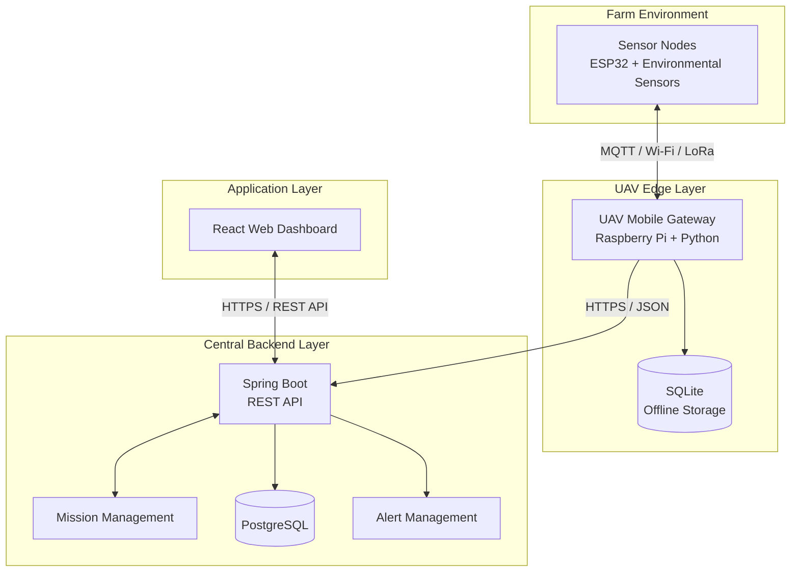
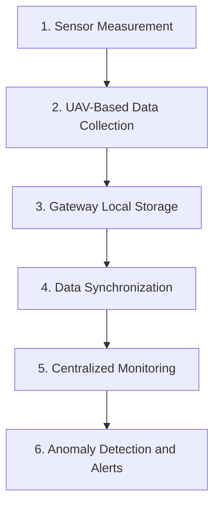
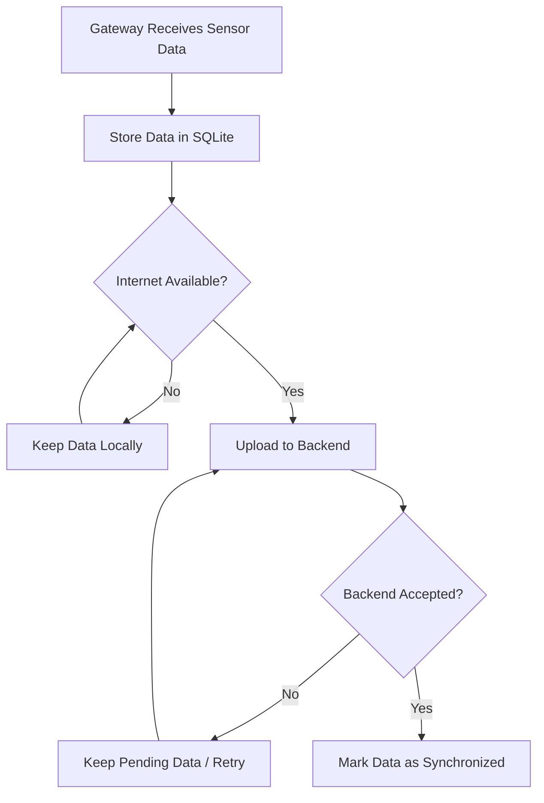

# UAV-Assisted IoT Platform for Farm Monitoring and Sensor Data Collection

An IoT-based farm monitoring platform that uses UAV-mounted mobile gateways to collect environmental data from distributed sensor nodes, synchronize measurements, and provide centralized farm monitoring.

<p align="center">
  **IoT · UAV Data Collection · Edge Computing · Spring Boot · React**
</p>

---

## 1. Project Overview

The **UAV-Assisted IoT Platform** is designed to collect, process, store, and visualize environmental data from distributed sensor nodes across agricultural areas.

Instead of installing fixed gateways throughout the farm, the system uses UAV-mounted Mobile Gateways to approach sensor nodes, retrieve stored measurements, and transfer collected data to a centralized Backend.

The platform supports offline data storage and automatic synchronization to ensure reliable data collection in environments with unstable Internet connectivity.

### Project Objectives

- Collect environmental data from distributed sensor nodes.
- Reduce the need for fixed gateway infrastructure.
- Provide reliable data collection through UAV-mounted Mobile Gateways.
- Support offline data storage and automatic synchronization.
- Centralize sensor data management and monitoring.
- Detect abnormal environmental conditions through configurable thresholds.
- Provide historical data visualization and reporting.

### Final Goal

Enable farm managers to monitor environmental conditions, detect abnormal values, and make data-driven decisions without manually visiting individual sensor devices.

---

## 2. Problems and Solutions

| Problem | Proposed Solution |
|---|---|
| Time-consuming data collection | Use UAV-mounted gateways to collect data from distributed sensors. |
| High infrastructure costs | Use mobile gateways instead of installing fixed gateways in every farm zone. |
| Unstable Internet connectivity | Store collected data locally and synchronize when connectivity is restored. |
| Distributed sensor data | Centralize measurements through the Backend and PostgreSQL. |
| Difficult environmental monitoring | Provide dashboards, historical charts, and zone comparisons. |
| Difficult anomaly detection | Evaluate measurements against configurable thresholds and generate alerts. |

---

## 3. System Architecture

The platform consists of five main architectural components:

1. Sensor Nodes
2. UAV Mobile Gateway
3. Backend and Mission Management
4. Database
5. Web Dashboard

### High-Level Architecture



### 3.1. Sensor and Monitoring Layer

**Purpose:** Measure environmental conditions at different locations within the farm.

Supported environmental measurements:

- Soil Moisture
- Air Temperature
- Air Humidity
- Light Intensity
- Soil pH
- Water Level

**Operating Process:**

1. Sensor Nodes periodically measure environmental parameters.
2. Measurements are temporarily stored on the sensor devices.
3. When a UAV Gateway approaches, the Sensor Node receives a collection request.
4. The Sensor Node authenticates the request and sends stored measurements to the Gateway.

**Proposed Technologies:**

| Technology | Purpose |
|---|---|
| ESP32 | Microcontroller |
| C/C++ | Sensor firmware development |
| GPIO / ADC / I2C | Hardware communication interfaces |
| ESP32 Flash Storage | Temporary measurement storage |
| Wi-Fi / LoRa | Wireless communication |

### 3.2. UAV Mobile Gateway

**Purpose:** Act as an intermediate communication and data collection unit between Sensor Nodes and the central Backend.

**Responsibilities:**

- Discover registered Sensor Nodes.
- Authenticate devices before collecting data.
- Request and receive sensor measurements.
- Record collection timestamps and location information.
- Store measurements locally when Internet connectivity is unavailable.
- Automatically synchronize stored measurements when connectivity is restored.

**Proposed Technologies:**

| Technology | Purpose |
|---|---|
| Raspberry Pi 4 | Gateway hardware prototype |
| Raspberry Pi OS | Operating system |
| Python | Gateway application development |
| SQLite | Offline data storage |
| Eclipse Paho MQTT | MQTT communication |
| Python HTTP Client | Backend communication |

**Scope Limitation:** The Gateway handles data collection and communication. Direct UAV flight control is outside the scope of the initial implementation.

### 3.3. Backend and Mission Management

**Purpose:** Process system operations, manage centralized data, and coordinate data collection missions.

**Backend Responsibilities:**

- Authenticate users and manage access permissions.
- Manage farms, zones, and sensor devices.
- Receive measurements from UAV Gateways.
- Validate incoming data.
- Detect duplicate records.
- Store measurements in PostgreSQL.
- Evaluate measurements against configured thresholds.
- Generate alerts.
- Provide REST APIs for frontend applications.

**Mission Management Responsibilities:**

- Manage UAVs and Mobile Gateways.
- Create data collection missions.
- Select farms and Sensor Nodes for each mission.
- Configure mission waypoints.
- Track mission status when telemetry is available.
- Record successful and failed collection points and failure reasons.

Mission Management handles mission information and operational status. It does not directly control UAV flight operations.

**Proposed Technologies:**

| Technology | Purpose |
|---|---|
| Java | Backend programming language |
| Spring Boot | REST API development |
| Spring Security | Authentication and authorization |
| Spring Data JPA | Database access |
| Hibernate | Object-relational mapping |
| Maven | Build and dependency management |
| JWT | Authentication tokens |

### 3.4. Database Layer

**Purpose:** Maintain centralized system information and historical sensor measurements.

**Central Database:** PostgreSQL

**Local Gateway Database:** SQLite

Main database entities:

- Users
- Farms
- Zones
- Sensors
- Measurements
- UAVs
- Gateways
- Missions
- Waypoints
- Collection Results
- Alerts

### 3.5. Web Dashboard

**Purpose:** Provide web interfaces for administrators and operators to manage and monitor the platform.

**Admin Functions:**

- Manage users, farms, and farm zones.
- Monitor sensor locations and device status.
- View current and historical measurements.
- Compare environmental data between farm zones.
- Configure alert thresholds.
- Manage alerts and view reports.

**Operator Functions:**

- Manage Sensor Nodes and UAV Gateways.
- Create data collection missions.
- Select sensors and configure waypoints.
- Monitor mission progress.
- Update mission status and operational notes.
- Review mission collection results.

**Proposed Technologies:**

| Technology | Purpose |
|---|---|
| React.js | Frontend framework |
| JavaScript | Frontend application logic |
| HTML5 / CSS3 | User interface |
| Axios | HTTP client |
| Leaflet.js | Interactive maps |
| OpenStreetMap | Geographic map data |
| Chart.js | Data visualization |

---

## 4. System Operating Workflow

The system operates through six main stages.



### Stage 1 – Sensor Measurement

Sensor Nodes periodically measure environmental parameters and temporarily store measurements on their devices.

### Stage 2 – UAV-Based Data Collection

The UAV carries the Mobile Gateway to sensor locations. The Gateway discovers registered devices, authenticates them, and requests stored measurements.

### Stage 3 – Gateway Data Storage

The Gateway receives measurements and records collection timestamps and location information.

When Internet connectivity is unavailable, measurements are stored locally in SQLite.

### Stage 4 – Data Synchronization and Processing

When connectivity is restored:

1. The Gateway uploads locally stored measurements to the Backend.
2. The Backend validates incoming data.
3. Duplicate records are detected.
4. Valid measurements are stored in PostgreSQL.

### Stage 5 – Data Monitoring

The Web Dashboard retrieves information from the Backend and displays:

- Device status.
- Current sensor measurements.
- Historical environmental data.
- Farm zone comparisons.
- Mission results.

### Stage 6 – Anomaly Detection and Notifications

The Backend compares sensor measurements against configured thresholds.

When abnormal conditions are detected, the system generates alerts and sends notifications through Web or Email.

---

## 5. Functional Modules

| Module | Main Responsibilities |
|---|---|
| User Management | Login, logout, account management, role-based access control |
| Farm Management | Manage farms, zones, and sensor locations |
| Sensor Management | Register, update, assign, and monitor Sensor Nodes |
| Data Collection | Discover, authenticate, and collect sensor measurements |
| UAV and Gateway Management | Manage UAV devices, Gateways, and operational status |
| Mission Management | Create missions, configure waypoints, and track collection results |
| Offline Storage and Synchronization | Store data locally, retry failed transmissions, and synchronize measurements |
| Data Monitoring | Display maps, current measurements, historical charts, and zone comparisons |
| Alert Management | Detect abnormal values and device conditions |
| Reporting | Generate sensor, device, alert, and mission reports |

---

## 6. Communication Architecture

The system uses different communication mechanisms depending on the connection between components.

| Communication Path | Technology | Purpose |
|---|---|---|
| Sensor Node ↔ Gateway | MQTT over Wi-Fi or LoRa-based communication | Exchange collection requests and measurement responses |
| Gateway ↔ Backend | HTTPS REST API with JSON | Upload measurements and synchronization status |
| Frontend ↔ Backend | HTTPS REST API with JSON | Retrieve and manage system information |
| Backend ↔ Database | Spring Data JPA / Hibernate | Store and retrieve centralized data |

### MQTT Request-Response Model

1. Gateway publishes a collection request to the Sensor Node.
2. Sensor Node receives the request and prepares stored measurements.
3. Sensor Node publishes the measurement response.
4. Gateway receives the response and stores it locally when necessary.

**Example MQTT Topics:**

```text
farm/{farmId}/sensor/{sensorId}/request
farm/{farmId}/sensor/{sensorId}/data
```

The MQTT broker can be hosted on the Gateway using Mosquitto for the local communication prototype.

The communication protocol must define:

- Device authentication.
- Message identification.
- Delivery handling.
- Timeout behavior.

---

## 7. Offline-First Architecture

A key requirement of the platform is reliable operation in agricultural areas with unstable Internet connectivity.

The system adopts an Edge-to-Cloud Hybrid approach combined with the Store-and-Forward mechanism.

**Edge Layer:**

- Collect measurements from Sensor Nodes.
- Temporarily store measurements on the Gateway.
- Maintain an offline synchronization queue.

**Cloud Layer:**

- Receive uploaded measurements.
- Validate and detect duplicates.
- Store centralized data.
- Provide monitoring and reporting services.

**Store-and-Forward Workflow:**



This mechanism helps prevent measurement loss during temporary network interruptions.

---

## 8. Technology Stack

| Layer | Technologies |
|---|---|
| Frontend | React.js, JavaScript, HTML5, CSS3, Axios |
| Mapping and Visualization | Leaflet.js, OpenStreetMap, Chart.js |
| Backend | Java, Spring Boot, Spring Security, Spring Data JPA, Hibernate |
| Authentication | JWT |
| Central Database | PostgreSQL |
| Gateway | Raspberry Pi 4, Raspberry Pi OS, Python |
| Gateway Storage | SQLite |
| Sensor Hardware | ESP32, C/C++ |
| Sensor Communication | MQTT, Wi-Fi, LoRa |
| Gateway Communication | HTTPS REST API, JSON |
| Deployment | Ubuntu Server 24.04 LTS, Docker, Docker Compose, Nginx |
| Version Control | Git, GitHub |
| CI/CD | GitHub Actions |
| API Testing | Postman |
| Backend Testing | JUnit 5, Mockito |
| Gateway Testing | Pytest |
| Development IDEs | IntelliJ IDEA, Visual Studio Code |

---

## 9. Testing Strategy

The project uses different testing tools to verify individual components and system integration.

| Tool | Testing Purpose |
|---|---|
| JUnit 5 | Backend unit testing |
| Mockito | Mock dependencies during backend testing |
| Postman | REST API and integration testing |
| Pytest | Gateway software testing |
| Browser Developer Tools | Frontend debugging and testing |

Key testing areas include:

- Sensor data validation.
- Device authentication.
- Gateway data collection.
- Offline data storage.
- Automatic synchronization.
- Duplicate measurement detection.
- Mission management.
- Threshold-based alert generation.
- Frontend and Backend integration.

---

## 10. Project Scope

### In Scope

- Develop Backend REST APIs and a central database.
- Develop Admin and Operator web interfaces.
- Develop or simulate environmental Sensor Nodes.
- Develop a UAV Mobile Gateway prototype.
- Discover, authenticate, and collect sensor measurements.
- Store collected data locally when Internet connectivity is unavailable.
- Automatically synchronize data when connectivity is restored.
- Manage UAV collection missions and mission results.
- Monitor current and historical sensor data.
- Generate threshold-based alerts.
- Generate sensor, device, alert, and mission reports.

### Out of Scope

- Direct UAV flight control.
- AI-based autonomous flight path planning.
- AI-based crop image analysis.
- AI-based crop yield prediction.
- Automated agricultural decision-making using AI.

---

## 11. Project Directory Structure

```text
UAV-Assisted-IoT-Platform/
│
├── deployment/
│   └── Deployment configurations
│
├── docs/
│   ├── api/
│   │   └── REST API specifications
│   ├── component_diagram/
│   │   └── Component diagrams
│   ├── requirements/
│   │   └── Functional and Non-Functional Requirements
│   └── uml/
│       └── Use Case, Class, Sequence, Activity, Deployment
│
├── src/
│   ├── backend/
│   │   └── Spring Boot Backend APIs and business logic
│   ├── dashboard/
│   │   └── React Admin and Operator interfaces
│   ├── gateway/
│   │   └── UAV Mobile Gateway software
│   ├── mission-management/
│   │   └── Mission management module
│   └── sensor-simulator/
│       └── Sensor Node simulation
│
├── test/
│   └── Test cases and system testing
│
├── .env.example
├── .gitignore
└── README.md
```

---

## 12. Expected Deliverables

At the end of the project, the team is expected to deliver:

1. Sensor Nodes capable of measuring and temporarily storing environmental data.
2. A UAV Mobile Gateway capable of discovering, authenticating, and collecting sensor measurements.
3. An offline storage and automatic synchronization mechanism.
4. A Spring Boot Backend capable of receiving, validating, deduplicating, and storing measurements.
5. A PostgreSQL database for centralized data management.
6. Admin and Operator web interfaces.
7. Mission management and collection result tracking.
8. Dashboard visualization for current and historical sensor data.
9. Threshold-based anomaly detection and notifications.
10. Reports covering sensor data, devices, alerts, and UAV missions.
11. Source code, deployment package, technical documentation, and user manuals.

---

## 13. Final Product

A working UAV-assisted IoT prototype that collects environmental data from distributed farm sensors, stores and synchronizes measurements reliably, manages collection missions, and provides a centralized platform for farm monitoring and decision support.

**Core System Capabilities:**

- UAV-assisted sensor data collection.
- Edge-based offline storage.
- Automatic data synchronization.
- Centralized data management.
- Real-time and historical monitoring.
- Mission management.
- Threshold-based anomaly detection.

---

<p align="center">
  **UAV-Assisted IoT Platform for Smart Farm Monitoring**
</p>
