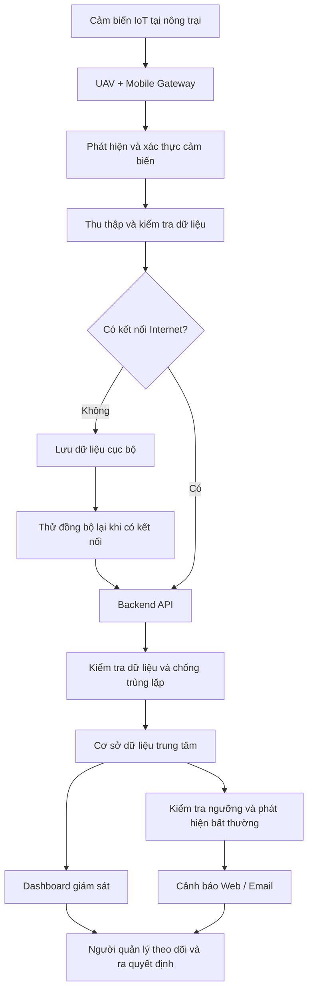

# UAV-Assisted IoT Platform for Farm Monitoring and Sensor Data Collection

**Nền tảng IoT có UAV hỗ trợ phục vụ giám sát và thu thập dữ liệu cảm biến nông trại**

## 1. Mục tiêu dự án

Xây dựng một nền tảng IoT sử dụng UAV (thiết bị bay không người lái) làm phương tiện hỗ trợ thu thập dữ liệu từ các nút cảm biến phân bố tại nhiều khu vực trong nông trại.

Hệ thống giúp thu thập, lưu trữ, đồng bộ và trực quan hóa dữ liệu cảm biến trên một nền tảng tập trung, ngay cả khi kết nối Internet không ổn định.

**Mục tiêu cuối cùng:** Người quản lý có thể theo dõi tình trạng nông trại, phát hiện các điều kiện bất thường và đưa ra quyết định dựa trên dữ liệu mà không cần thu thập và kiểm tra từng cảm biến thủ công.

## 2. Hệ thống giải quyết vấn đề gì?

* **Thu thập dữ liệu tốn thời gian:** UAV hỗ trợ tiếp cận các nút cảm biến phân bố trên diện tích rộng và thu thập dữ liệu.
* **Internet không ổn định:** Gateway gắn trên UAV lưu dữ liệu cục bộ và đồng bộ lên máy chủ khi có kết nối trở lại.
* **Dữ liệu phân tán:** Backend và cơ sở dữ liệu tập trung dữ liệu từ nhiều cảm biến, khu vực và trang trại.
* **Khó theo dõi sự thay đổi:** Dashboard hiển thị dữ liệu hiện tại, lịch sử và so sánh giữa các khu vực.
* **Khó phát hiện điều kiện bất thường:** Hệ thống kiểm tra dữ liệu theo ngưỡng cấu hình và gửi cảnh báo cho người quản lý.

## 3. Các chức năng chính

| Nhóm chức năng         | Mô tả                                                                          |
| ---------------------- | ------------------------------------------------------------------------------ |
| Quản lý người dùng     | Đăng nhập, đăng xuất và phân quyền truy cập                                    |
| Quản lý nông trại      | Quản lý trang trại, khu vực và vị trí cảm biến                                 |
| Quản lý cảm biến       | Đăng ký thiết bị, theo dõi trạng thái và cấu hình ngưỡng                       |
| Thu thập dữ liệu       | Thu thập nhiệt độ, độ ẩm, ánh sáng, pH, độ ẩm đất và mực nước                  |
| Quản lý UAV và gateway | Quản lý thiết bị thu thập và trạng thái hoạt động                              |
| Quản lý nhiệm vụ       | Tạo nhiệm vụ, chọn cảm biến, thiết lập điểm tham chiếu và ghi nhận kết quả     |
| Lưu trữ và đồng bộ     | Lưu dữ liệu ngoại tuyến, tự động thử lại và đồng bộ khi có Internet            |
| Giám sát dữ liệu       | Hiển thị bản đồ, dữ liệu hiện tại, biểu đồ lịch sử và so sánh giữa các khu vực |
| Cảnh báo               | Phát hiện giá trị bất thường và gửi thông báo trên web hoặc email              |
| Báo cáo                | Tổng hợp dữ liệu cảm biến, thiết bị, cảnh báo và nhiệm vụ UAV                  |

## 4. Sơ đồ hoạt động của hệ thống

## 5. Nguyên lý hoạt động

1. **Thu thập:** Các cảm biến đo điều kiện môi trường tại những khu vực khác nhau trong nông trại.
2. **Tiếp nhận:** UAV mang gateway đến gần các cảm biến để phát hiện, xác thực và lấy dữ liệu.
3. **Lưu trữ:** Gateway lưu dữ liệu tại chỗ nếu không có Internet; khi có kết nối, dữ liệu được đồng bộ lên backend.
4. **Xử lý:** Backend kiểm tra tính hợp lệ, xử lý bản ghi trùng lặp và lưu dữ liệu vào cơ sở dữ liệu.
5. **Giám sát:** Dashboard hiển thị dữ liệu, lịch sử đo, trạng thái thiết bị và kết quả nhiệm vụ.
6. **Cảnh báo:** Hệ thống so sánh dữ liệu với ngưỡng đã cấu hình và thông báo khi phát hiện bất thường.

## 6. Phạm vi dự án

Dự án tập trung vào thu thập dữ liệu cảm biến, lưu trữ ngoại tuyến, đồng bộ dữ liệu, giám sát, cảnh báo và quản lý nhiệm vụ UAV.

Điều khiển bay trực tiếp UAV và phân tích hình ảnh cây trồng bằng trí tuệ nhân tạo không thuộc phạm vi triển khai ban đầu.

## 7. Kết quả mong đợi

Một hệ thống mẫu có thể thu thập dữ liệu từ cảm biến, lưu trữ và đồng bộ dữ liệu an toàn, hiển thị thông tin trên dashboard, phát hiện bất thường và hỗ trợ người quản lý giám sát nông trại tập trung.
