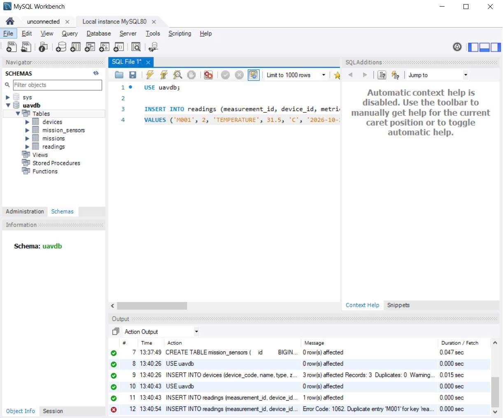

DATABASE SCHEMA

 1. Sơ đồ ERD

 2. Danh sách bảng
| Bảng | Mục đích |
|---|---|
| devices | Lưu cảm biến, gateway, UAV |
| readings | Lưu từng lần đo của cảm biến |
| missions | Lưu nhiệm vụ UAV |
| mission_sensors | Lưu cảm biến nào thuộc nhiệm vụ nào |

 3. Quan hệ giữa các bảng
- Một device có nhiều readings.
- Một UAV (device) thực hiện nhiều missions.
- Một mission có nhiều cảm biến, một cảm biến thuộc nhiều mission
  (quan hệ nhiều-nhiều nên cần bảng trung gian mission_sensors).

 4. Lý do thiết kế
- measurement_id UNIQUE: chống lưu trùng khi Gateway gửi lại.
- Tách measured_at và received_at: cảm biến đo lúc offline, có mạng mới gửi lên.
- Index (device_id, measured_at): truy vấn lịch sử nhanh.
- UNIQUE (mission_id, device_id): một cảm biến không bị thêm hai lần vào một nhiệm vụ.
- uav_device_id NOT NULL: mọi nhiệm vụ bắt buộc phải có UAV thực hiện.

 5. Kiểm thử

Chạy lại cùng một INSERT với measurement_id = M001 thì MySQL báo lỗi
1062 Duplicate entry, chứng minh cơ chế chống trùng hoạt động.

 6. Cách chạy
Chạy file schema.sql trong MySQL (Workbench hoặc phpMyAdmin) để tạo database uavdb.