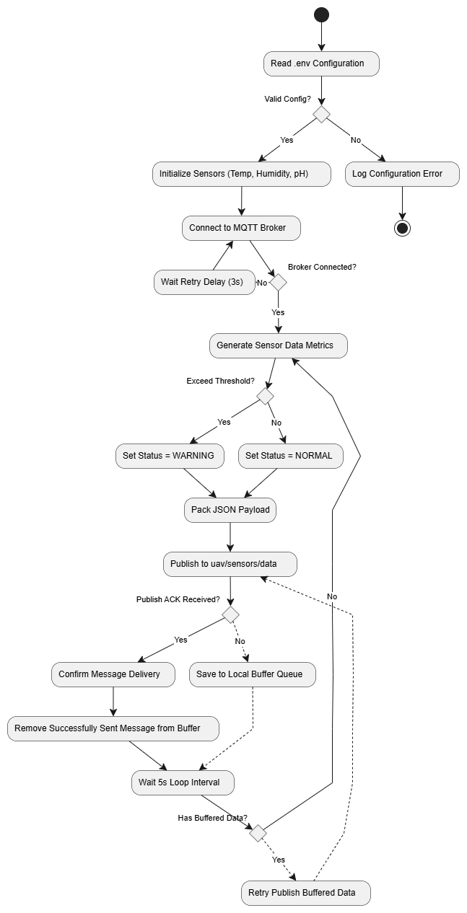

# Sensor Simulator Module (Core IoT Data Engine)

Thành phần chịu trách nhiệm giả lập hạ tầng cảm biến nông nghiệp đa điểm thuộc dự án **UAV-Assisted IoT Platform for Farm Monitoring**.

## 📊 Định dạng dữ liệu đầu ra (JSON)
```json
{
  "seq": 1,
  "device_id": "SENSOR_01",
  "sensor_type": "TEMPERATURE",
  "value": 29.50,
  "status": "NORMAL",
  "timestamp": "2026-10-26T13:00:00Z"
}
---

## 📐 Activity Diagram (Sơ đồ hoạt động UML 2.5)

Sơ đồ thể hiện toàn bộ luồng vận hành từ khởi tạo cấu hình, kết nối MQTT Broker, phát dữ liệu định kỳ đến các cơ chế xử lý ngoại lệ (Buffer Queue & Retry Mechanics).



### 🔍 Mô tả các thành phần và luồng xử lý:

1. **Initialization Phase (Khởi tạo hệ thống):**
   * **Read .env Configuration:** Đọc các thông số môi trường (`BROKER_URL`, `PORT`, `INTERVAL`,...).
   * **Valid Config?:** Kiểm tra tính hợp lệ của cấu hình. Nếu thiếu hoặc lỗi cấu hình, ghi log lỗi (`Log Configuration Error`) và dừng ứng dụng tại nút kết thúc (Final State).
   * **Initialize Sensors:** Khởi tạo các cảm biến ảo (Temp, Humidity, pH).

2. **Network Connection & Auto-Retry (Kết nối MQTT):**
   * **Connect to MQTT Broker & Broker Connected?:** Thiết lập kết nối tới Broker. Nếu mất kết nối (`No`), hệ thống chờ 3 giây (`Wait Retry Delay (3s)`) rồi tự động thử kết nối lại.

3. **Data Generation & Threshold Evaluation (Sinh dữ liệu & Kiểm tra ngưỡng):**
   * **Generate Sensor Data Metrics:** Sinh chỉ số cảm biến giả lập định kỳ.
   * **Exceed Threshold?:** Đánh giá chỉ số so với ngưỡng an toàn:
     * Vượt ngưỡng: Gán `Set Status = WARNING`.
     * Trong ngưỡng: Gán `Set Status = NORMAL`.
   * **Pack JSON Payload:** Đóng gói thông tin và trạng thái thành chuỗi dữ liệu chuẩn JSON.

4. **Publish, Buffer Queue & Retry Mechanics (Gửi dữ liệu & Xử lý hàng đợi):**
   * **Publish to uav/sensors/data:** Bắn gói tin JSON tới topic MQTT `uav/sensors/data`.
   * **Publish ACK Received?:** Kiểm tra phản hồi xác nhận từ Broker:
     * **Nhánh Yes:** Gọi `Confirm Message Delivery` và thực hiện `Remove Successfully Sent Message from Buffer` (xóa bản tin đã gửi khỏi bộ đệm).
     * **Nhánh No:** Đưa bản tin vào `Save to Local Buffer Queue` để lưu tạm trong bộ nhớ cục bộ.
   * **Wait 5s Loop Interval & Has Buffered Data?:** Sau mỗi chu kỳ 5 giây, kiểm tra hàng đợi cục bộ:
     * **Nếu có dữ liệu đệm (`Yes`):** Thực hiện `Retry Publish Buffered Data` đẩy ngược gói tin cũ về bước `Publish to uav/sensors/data` để kiểm tra lại ACK.
     * **Nếu không có dữ liệu đệm (`No`):** Quay lại luồng tạo dữ liệu cảm biến mới (`Generate Sensor Data Metrics`).

---

## 🧪 Test Scenarios (Kịch bản kiểm thử)

Chi tiết các kịch bản kiểm thử được định nghĩa trong `TestScenarios.md`:
* **Normal Operation:** Gửi dữ liệu định kỳ với trạng thái `"status": "NORMAL"`.
* **Anomaly Injection:** Kích hoạt cảnh báo vượt ngưỡng dựa trên cấu hình `.env` với `"status": "WARNING_ANOMALY"`.
* **Node Offline:** Giả lập thiết bị dừng gửi dữ liệu/timeout để kiểm thử cơ chế Buffer và Retry.